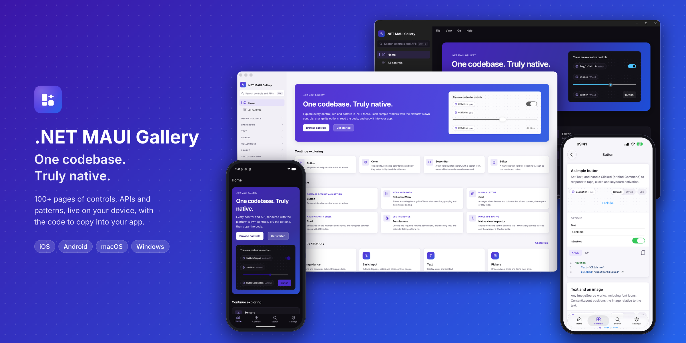
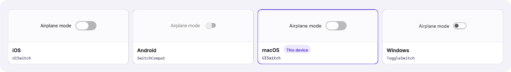

<h1 align="center">.NET MAUI Gallery</h1>
<p align="center">
  <strong>Browse .NET MAUI controls, APIs and patterns, run them on your device, and copy the code into your own app.</strong>
</p>
<p align="center">
  <a href="https://github.com/jfversluis/maui-gallery/actions/workflows/ci.yml"></a>
  <a href="LICENSE"></a>
</p>

New to .NET MAUI? The .NET MAUI Gallery is a hands-on tour of the framework: more than 100 interactive pages that
show what it can do, running on your phone, tablet or computer. Try a control, change its options, see the XAML and
C# update, and copy the code into your app.

Samples render with each platform's **own native controls**. The same `<Switch />` becomes a `UISwitch` on iOS and
macOS, a `SwitchCompat` on Android and a `ToggleSwitch` on Windows, and the gallery shows you which one.

> [!NOTE]
> The .NET MAUI Gallery isn't in the app stores yet. Until then, you can
> [build and run it from source](#build-and-run-from-source).

## Features

- **Interactive samples.** Controls, layouts, dialogs, menus, collections, media, graphics and more, each with
  several examples, from the basics to real-world scenarios.
- **Options you can change.** Adjust text, colors, sizes and modes, and watch the control respond.
- **Code that follows along.** XAML and C# tabs update with the options you change, with syntax highlighting and a
  copy button.
- **Native by design.** A badge shows the platform control behind a sample (`UIButton`, `MaterialButton`, `Button`).
  Switch a sample between the platform's **Default** look and a **Styled** version, or flip it to right-to-left.
  Selected control pages show the same sample captured on iOS, Android, macOS and Windows, side by side.
- **Beyond controls.** Data binding, styles, triggers, animations, gestures, accessibility, Shell navigation,
  multiple windows, deep links, HybridWebView, Blazor Hybrid, handlers and platform code.
- **Device and system APIs.** Sensors, location, battery, connectivity, clipboard, sharing, text-to-speech, file
  and media pickers and secure storage, with permission requests done right.
- **At home on every device.** Bottom tabs on phones, a sidebar on tablets and unfolded foldables. On macOS and
  Windows, a sidebar that adapts as you resize, a menu bar, keyboard shortcuts and multiple windows. Search with <kbd>⌘</kbd>+<kbd>K</kbd> on macOS or
  <kbd>Ctrl</kbd>+<kbd>K</kbd> on Windows, and keep favorites. Light and dark themes everywhere.
- **Design guidance.** Pages on color, typography, iconography, spacing, shape and responsive design explain the
  design system behind the app.

<p align="center">
  
</p>

## Supported platforms

| Platform | Minimum version |
| --- | --- |
| iOS and iPadOS | 15 |
| macOS (Mac Catalyst) | macOS 14 Sonoma |
| Android | 7.0 (API 24) |
| Windows | Windows 10 version 1809 |

## Build and run from source

### 1. Set up your environment

- The [.NET 11 SDK](https://dotnet.microsoft.com/download/dotnet/11.0), 11.0.100 or later.
- For iOS and macOS: a Mac with Xcode 27.2.
- For Android: a JDK (21 recommended) and the Android SDK, plus an emulator or a device.
- For Windows: a Windows PC.

The [.NET MAUI installation guide](https://learn.microsoft.com/dotnet/maui/get-started/installation) walks you through
each of these. To use an IDE, install [Visual Studio 2026](https://visualstudio.microsoft.com/) on Windows, or
[Visual Studio Code](https://code.visualstudio.com/) with the
[.NET MAUI extension](https://marketplace.visualstudio.com/items?itemName=ms-dotnettools.dotnet-maui).

### 2. Clone the repository and install the workloads

```bash
git clone https://github.com/jfversluis/maui-gallery.git
cd maui-gallery
dotnet workload restore src/MauiGallery
```

`dotnet workload restore` installs the workloads this project needs. If .NET is installed system-wide on macOS or
Linux, run it with `sudo`.

### 3. Build and run

| Platform | Build on | Command |
| --- | --- | --- |
| macOS (Mac Catalyst) | macOS | `dotnet run --project src/MauiGallery -f net11.0-maccatalyst` |
| iOS simulator | macOS | `dotnet run --project src/MauiGallery -f net11.0-ios` |
| Android emulator or device | macOS, Windows or Linux | `dotnet run --project src/MauiGallery -f net11.0-android` |
| Windows | Windows | `dotnet run --project src/MauiGallery -f net11.0-windows10.0.19041.0` |

If more than one simulator, emulator or device is available, `dotnet run` asks which one to use. Add `--list-devices`
to see them, or `--device <id>` to pick one. Running on a physical iPhone or iPad also needs an Apple developer account
and a provisioning profile. In an IDE, open `MauiGallery.slnx`, pick a target and press <kbd>F5</kbd>.

> [!NOTE]
> The Map page needs a key on two platforms. Android uses Google Maps: add `-p:MapsApiKey=<your key>` to the Android
> command, or the page tells you it's missing. Windows uses Azure Maps: paste your own key on the Map page, or build
> with `-p:AzureMapsKey=<your key>`. iOS and macOS use Apple Maps and need no key.

## Feedback and contributing

Found a bug, or missing a control, an example or a platform note? Contributions are very welcome.

- [Open an issue](https://github.com/jfversluis/maui-gallery/issues). For bugs, include your device, OS version, the
  app version (Settings, About) and the steps to reproduce.
- Looking for a place to start? Try an issue labeled
  [help wanted](https://github.com/jfversluis/maui-gallery/issues?q=is%3Aopen+is%3Aissue+label%3A%22help+wanted%22)
  or [good first issue](https://github.com/jfversluis/maui-gallery/issues?q=is%3Aopen+is%3Aissue+label%3A%22good+first+issue%22).
- [CONTRIBUTING.md](CONTRIBUTING.md) walks you through adding a sample page, and
  [docs/design-system.md](docs/design-system.md) explains the look and feel.

This repository is also set up for AI coding agents: [AGENTS.md](AGENTS.md), agent skills in
[.github/skills](.github/skills) and DevFlow let agents such as GitHub Copilot build, run, inspect and verify the app.
See [docs/agents.md](docs/agents.md).

## Learn more

- [.NET MAUI documentation](https://learn.microsoft.com/dotnet/maui/)
- [Build mobile and desktop apps with .NET MAUI](https://learn.microsoft.com/training/paths/build-apps-with-dotnet-maui/)
  on Microsoft Learn
- [.NET MAUI samples](https://github.com/dotnet/maui-samples)
- [.NET MAUI on GitHub](https://github.com/dotnet/maui)
- [.NET MAUI Labs](https://github.com/dotnet/maui-labs): DevFlow, the `maui` CLI and the agent skills used here

## Contributors

Thanks to everyone who has contributed!

[](https://github.com/jfversluis/maui-gallery/graphs/contributors)

## License and privacy

The .NET MAUI Gallery is licensed under the [MIT license](LICENSE). Third-party fonts and icons are listed in the app
under Settings, Third-party notices. The app itself collects no data; see the [privacy policy](docs/privacy.md).
